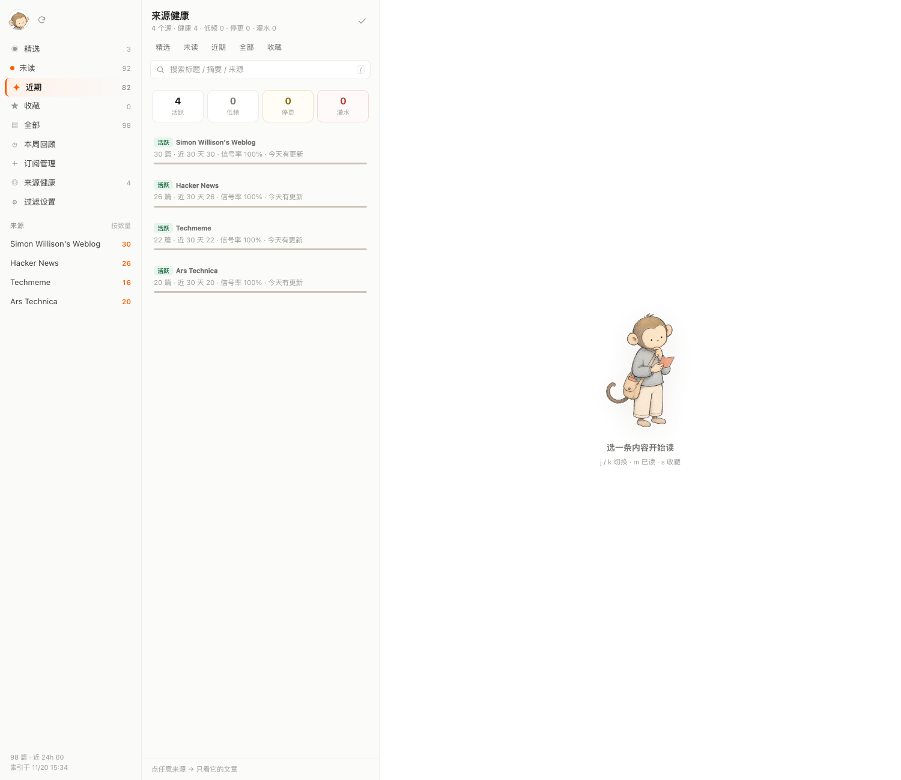
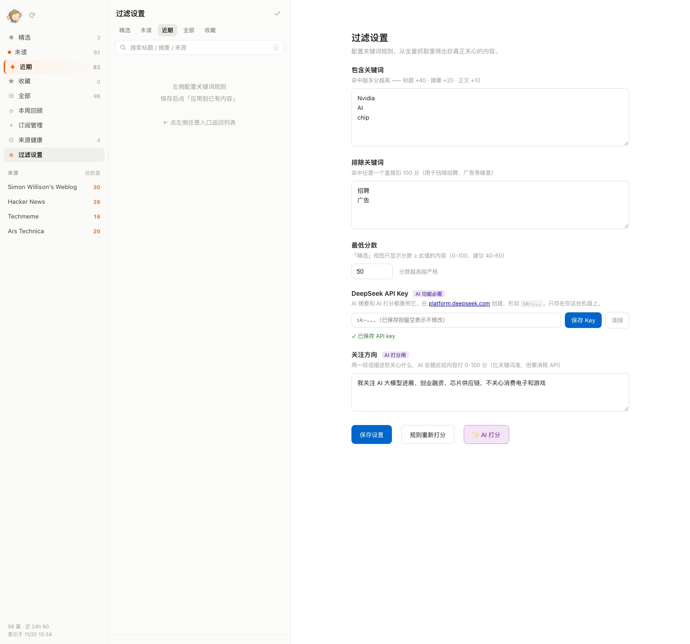
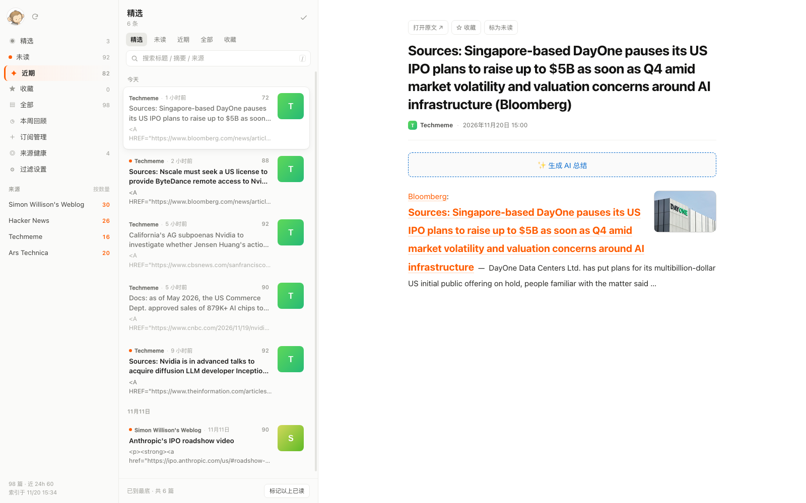

# 六耳 AI资讯情报站

本地 RSS 阅读器，三栏布局，全文搜索，来源健康度，OPML 导入。一个 DeepSeek Harness 插件，装好就能用，不依赖任何外部流水线。

## 效果预览

### 桌面端


三栏布局：侧栏导航 → 卡片时间线 → 正文阅读

### 移动端


汉堡菜单 + 单栏阅读，375px 自适应

### 订阅管理


单条添加 / 批量粘贴 / OPML 导入，三种方式

### 来源健康度


自动标出停更、低频、灌水的源

### 过滤设置


关键词规则 + 分数阈值，从全量抓取里筛出你关心的内容

### 精选视图


只显示达到分数阈值的内容，卡片右上角是分数

## 安装

```bash
# 终端一行命令（装完重启 DSH）
dsh plugin --profile web add github:scar119/liuer-intel-station

# 或者 DSH 界面里：插件 → 从 URL 安装 → 粘贴
https://github.com/scar119/liuer-intel-station
```

装完重启，侧边栏出现「情报站」图标。

> 需要 Python 3 在 PATH 里（`python3` 命令可用）。macOS/Linux 自带，Windows 装一个即可。

## 它是什么

把你订阅的 RSS 源汇总成一个三栏阅读面板：

```
┌──────────┬──────────────┬─────────────────────┐
│ 未读/近期 │ 筛选 + 搜索   │ 标题                 │
│ 收藏/全部 │ ───────────  │ 来源 · 时间          │
│ 订阅管理  │ 卡片流        │ ┌ AI 总结（可选）──┐ │
│ 本周回顾  │ (按天分隔)    │ └─────────────────┘ │
│ 来源健康  │              │ 正文                 │
│ 来源列表  │ 标记以上已读  │                      │
└──────────┴──────────────┴─────────────────────┘
```

## 核心功能

- **三栏阅读器**：侧栏导航 → 卡片时间线 → 正文阅读
- **全文搜索**：SQLite FTS5 trigram，中文子串可搜，含正文前 600 字
- **订阅管理**：单条添加 / 批量粘贴 / OPML 导入，三种方式
- **内置 RSS 抓取**：自带抓取引擎，无需外部流水线
- **内容筛选（两级）**：关键词规则打分（不花钱）+ AI 语义打分（更准）
- **自动定时抓取**：一行命令装好每日自动更新
- **来源健康度**：自动标出停更、低频、灌水的源
- **周回顾**：产量趋势、最活跃来源
- **已读/收藏**：状态跨会话保留
- **AI 总结**：接入你自己的 DeepSeek API key，一键生成文章摘要

## 内容筛选怎么用

抓取是全量的（不丢任何内容），筛选发生在**展示层**——所以你随时可以改规则，不用重新抓。

进「过滤设置」配置三件事：

### 1. 包含关键词

命中越多，分数越高：

| 命中位置 | 加分 |
|---|---|
| 标题 | +40 |
| 摘要 | +20 |
| 正文 | +10 |

比如你关注 AI，填 `AI`、`LLM`、`芯片`，标题里带「AI」的文章直接 40 分。

### 2. 排除关键词

命中任意一个直接扣 100 分（用于挡掉噪音）：

```
招聘
广告
推广
```

### 3. 最低分数

「精选」视图只显示分数 ≥ 此值的内容。建议 40-60：

- `40` 宽松（标题命中一个关键词就过）
- `50` 适中（默认）
- `70` 严格（标题 + 摘要/正文都命中）

配置完点「保存设置」，再点「应用到已有内容」对历史内容重新评分。

### 背后的评分逻辑

```
标题命中 +40 / 摘要命中 +20 / 正文命中 +10
排除词命中 -100
最终 clamp 到 0-100
```

打开「精选」视图，卡片右上角会显示每篇的分数（绿色 ≥70，黄色 ≥40）。

### 两级筛选：规则先筛，AI 再判

规则筛选不花钱但只看字面。要更准就加一步 AI：

在「过滤设置」最下面填 **关注方向**（一段话就行）：

> 我关注 AI 大模型进展、创业融资、芯片供应链，不关心消费电子和游戏

然后点「✨ AI 打分」。AI 会给每篇内容打 0-100 分，`精选` 视图自动改用 AI 分（没打过 AI 分的仍用规则分兜底）。

**省钱的关键**：AI 只给**规则分已经过线**的内容打分。1000 条的资讯日，可能只有 30 条进 AI，API 成本几乎可忽略。

需要先在 DSH 插件设置里填 `deepseekApiKey`。

## 让它自己每天跑

装好插件后，跑一次这个脚本就不用再手动点了：

```bash
# 在插件目录里执行
./install-schedule.sh                  # 每天 07:00 自动抓取
./install-schedule.sh --time 06:30     # 自定义时间
./install-schedule.sh --ai             # 抓完顺便 AI 打分
./install-schedule.sh --status         # 看装没装、最近日志
./install-schedule.sh --uninstall      # 卸载
./install-schedule.sh --run-now        # 立刻跑一次（测试）
```

macOS 用 launchd，Linux 用 cron，脚本自动判断。日志在 `~/Library/Logs/liuer-intel-station.log`。

> 用 `--ai` 的话，需要把 key 单独放一份给定时任务用：
> ```bash
> echo 'sk-xxxx' > ~/.liuer-intel-station/.deepseek_key
> chmod 600 ~/.liuer-intel-station/.deepseek_key
> ```

## 快速开始

1. 装完重启 DSH，侧栏点「情报站」
2. 进「订阅管理」→ 粘贴你的 RSS 地址（或导入 OPML）
3. 点「立即抓取」
4. 进「过滤设置」→ 填你关注的关键词 → 保存 → 应用到已有内容
5. 回「精选」看筛出来的内容，或「未读」看全量

## 键盘快捷键

| 键 | 功能 |
|---|---|
| `j` / `k` | 下 / 上一篇 |
| `Shift+j/k` | 跳过已读 |
| `m` | 切换已读 |
| `s` | 切换收藏 |
| `o` / `Enter` | 打开原文 |
| `/` | 搜索 |
| `Esc` | 退出搜索 |

## 数据存哪

所有数据存在 `~/.liuer-intel-station/`：

- `intel.db` — SQLite（条目 + 全文索引）
- `feeds.json` — 订阅源列表
- `config.json` — 用户配置

**你的订阅源和阅读数据只在你本机，不会上传到任何地方。**

## 工作原理

```
DSH 插件（Host 半边）
  │
  ├─ 静态文件：三栏阅读器（HTML/CSS/JS，无框架）
  ├─ RSS 抓取：Python 引擎并发拉取订阅源，解析条目
  │             → 写入 SQLite（去重 + FTS5 全文索引）
  └─ 查询 API：/api/items /api/search /api/sources ...
```

引擎是 12 个零依赖的 Python 脚本（`engines/`），只用标准库。

## 配置

在 DSH 插件设置里（或 `~/.liuer-intel-station/config.json`）：

| 配置项 | 默认值 | 说明 |
|---|---|---|
| `include` | `[]` | 包含关键词（数组） |
| `exclude` | `[]` | 排除关键词（数组） |
| `minScore` | `50` | 精选视图的分数阈值 |
| `interests` | 空 | 关注方向（AI 打分用，一段话） |
| `deepseekApiKey` | 空 | DeepSeek API key（用于 AI 总结） |

前 3 项在界面「过滤设置」里改；`deepseekApiKey` 在 DSH 插件设置里填。

## 已知限制

| 限制 | 说明 | 计划 |
|---|---|---|
| **AI 功能需配置 API key** | AI 摘要和 AI 打分都要 DeepSeek API key | — |
| **更新需重启 DSH** | 修改代码后热重载会报 `duplicate route`，必须重启 | DSH 限制，暂无解 |
| **数据目录固定** | 默认 `~/.liuer-intel-station`，无法在 GUI 改 | 后续加 Config schema |
| **Windows 未测试** | 只在 macOS 验证过 | 需要社区反馈 |

## 常见问题

**Q：为什么装完没反应？**
重启 DSH。检查 `python3 --version` 能跑。

**Q：抓取失败？**
有些源需要科学上网，或源本身已失效。点「来源健康」看状态。

**Q：数据会同步到云端吗？**
不会。纯本地。

**Q：和你的「每日信息萃取」是什么关系？**
这个插件是从我的私有系统提炼出来的开源版。原系统有 AI 分类和日报生成，但依赖我的私有流水线。这个开源版是自足的：用户自己添加源、自己抓取、自己读，不依赖任何外部服务。

## 开发

```bash
git clone https://github.com/scar119/liuer-intel-station
cd liuer-intel-station
# 引擎端到端测试
python3 engines/schema.py /tmp/test.db
python3 engines/fetch_feeds.py /tmp/testdir /tmp/test.db
```

## License

MIT