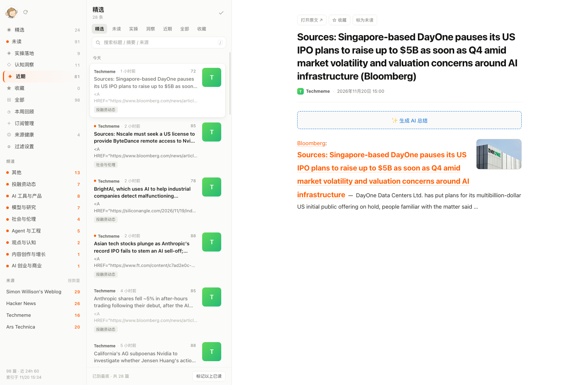
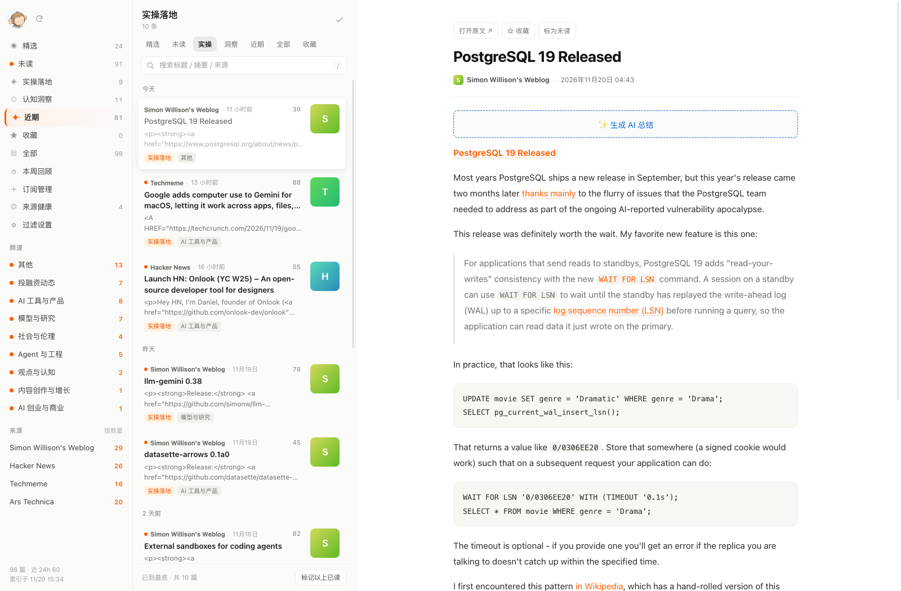
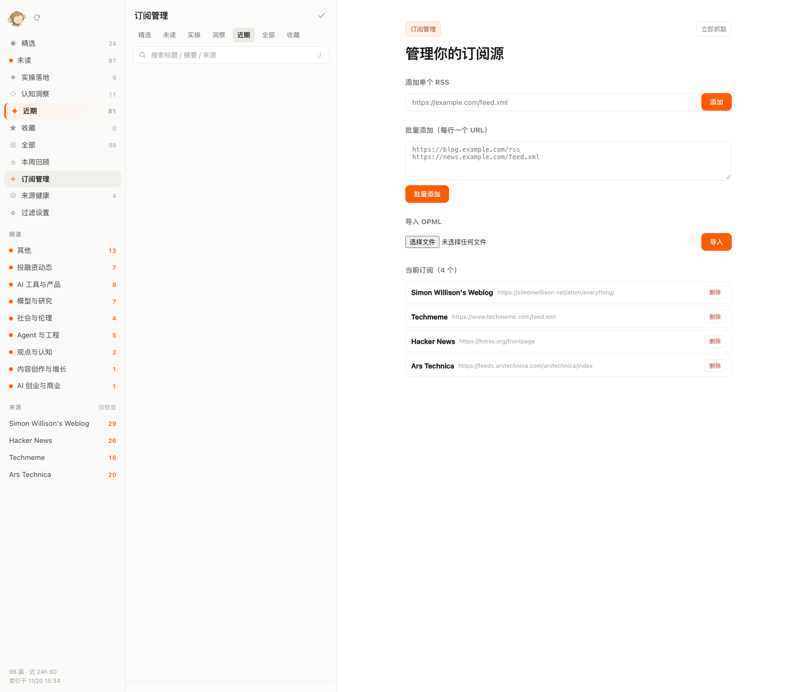

# 六耳 AI资讯情报站

本地 RSS 阅读器，三栏布局，全文搜索，来源健康度，OPML 导入。一个 DeepSeek Harness 插件，装好就能用，不依赖任何外部流水线。

## 效果预览

### 桌面端：三栏阅读 + AI 分级



左侧导航、中间卡片列表、右侧正文。侧栏有「精选 / 未读 / 实操落地 / 认知洞察 / 近期 / 收藏 / 全部」六个视图，以及 AI 分好的频道和来源列表。

### AI 自动分级：实操落地 / 认知洞察



AI 会给每篇内容打三样东西：**相关度分数**（0-100）、**内容类型**（实操落地 / 认知洞察 / 纯资讯）、**所属频道**。侧栏的「实操落地」「认知洞察」就是按类型筛出来的，「频道」区块按频道筛。

同一批 AI 调用顺带完成，不额外花钱。

### 移动端：单栏自动切换


390px 宽度下自动收成单栏，默认显示卡片列表。点开一篇切到正文，正文左上角出现「‹ 返回列表」。

### 订阅管理：三种添加方式



单个添加、批量粘贴、OPML 导入三种方式都在这一页，下方「当前订阅」列出已添加的源，可逐个删除。

### 来源健康度


每个源显示：状态（活跃 / 低频 / 停更 / 灌水）、总篇数、近 30 天篇数、信号率、最后更新时间。

### 过滤设置


五个区块：包含关键词、排除关键词、最低分数、DeepSeek API Key、关注方向。底部三个按钮：「保存设置」「规则重新打分」「✨ AI 打分」。

---

## 再往上一步：作者自己的定制版

上面是开箱即用的形态。这个插件最早是从作者自己的资讯系统里提炼出来的，原版长这样：


比开源版多了三样东西：

| 多出来的 | 怎么做到的 | 需要什么 |
|---|---|---|
| **今日日报** | 每天定时跑一次，AI 把当天高分内容写成一整篇 Markdown 日报 | 一个报告生成脚本 + 定时任务 |
| **更多频道** | 按自己的行业重新定义频道列表，AI 按新分类打标 | 改 `config.json` 里的 `channels` |
| **3 万篇历史积累** | 长期跑积累下来的存量，不是几天的新内容 | 时间 |

也就是说，这套东西的**上限取决于你愿意往里喂多少**：

| 你投入的 | 得到的效果 |
|---|---|
| 装完就用 | 三栏 RSS 阅读器 + 全文搜索 |
| + 填关键词 | 规则筛掉噪音 |
| + 填 AI key 和关注方向 | AI 打分 + 自动分频道 + 分实操/洞察 |
| + 改频道列表 | 按你所在行业重新分类 |
| + 加定时任务 | 每天自动更新 |
| + 加日报脚本 | 每天一份 AI 写的日报（需自己写，约 100 行） |

## 安装前你需要知道的

| 项目 | 要求 | 为什么 |
|---|---|---|
| **Python 3.9+** | `python3 --version` 能跑 | 抓取引擎是 Python 写的，只用标准库 |
| **DeepSeek Harness** | 已在用 | 这是个 DSH 插件 |
| **DeepSeek API key** | 可选 | 只有 AI 摘要 / AI 打分需要；不填也能正常当 RSS 阅读器用 |
| **磁盘空间** | 几十 MB | 1 万篇带全文索引约 60MB |

macOS / Linux 自带 Python 3。Windows 需要自己装一个并确保 `python3` 在 PATH 里。

## 安装

```bash
# 终端一行命令
dsh plugin --profile web add github:scar119/liuer-intel-station
```

或者在 DSH 界面里：**插件 → 从 URL 安装** → 粘贴 `https://github.com/scar119/liuer-intel-station`

### 装完如果侧栏没出现，重启 DSH

多数情况装完就生效。如果侧栏没有「情报站」图标，重启 DSH 一次（新安装的 JS 模块需要重新加载）。

**之后的版本更新不用重启**：更新代码后禁用再启用一次插件即可，路由会正确注销和重新注册。

---

## 首次使用：5 步上手

### 第 1 步 · 打开情报站

重启 DSH 后，点侧栏的「情报站」。第一次打开会看到引导卡片：


界面分三栏：**左侧导航** → **中间卡片列表** → **右侧正文**。

### 第 2 步 · 添加订阅源

点左侧「＋ 订阅管理」，三种方式任选：


| 方式 | 怎么用 | 适合 |
|---|---|---|
| **单条添加** | 粘贴一个 RSS 地址，回车 | 偶尔加一个 |
| **批量粘贴** | 多行文本框，每行一个 URL | 从别处复制一批 |
| **OPML 导入** | 上传 `.opml` 文件 | 从 Feedly / Inoreader 等迁移过来 |

> RSS 地址长这样：`https://example.com/feed.xml` 或 `https://example.com/rss`。
> 不知道网站有没有 RSS？多数博客在网址后加 `/feed` 或 `/rss` 试试。

### 第 3 步 · 抓取

在订阅管理页点「**立即抓取**」。第一次抓 10 个源大约 3-5 秒。

抓完回左侧「未读」，卡片就出来了。

### 第 4 步 ·（可选）配置 AI key

只有要用 **AI 摘要** 或 **AI 打分** 才需要这步。

1. 去 [platform.deepseek.com/api_keys](https://platform.deepseek.com/api_keys) 创建一个 key（形如 `sk-...`）
2. 回到情报站 → 左侧「⚙ 过滤设置」→ 最上面「DeepSeek API Key」
3. 粘贴进去 → 点「保存 Key」


保存后状态会显示 `✓ 已保存 API key`。key 存在 `~/.liuer-intel-station/.deepseek_key`，权限 600，只有你能读。

### 第 5 步 ·（可选）配置筛选

同一页往下，三个东西：

**① 包含关键词** — 每行一个。命中加分：标题 +40 / 摘要 +20 / 正文 +10

```
AI
LLM
芯片
创业
```

**② 排除关键词** — 每行一个。命中直接扣 100 分，用来挡噪音

```
招聘
广告
推广
```

**③ 最低分数** — 「精选」视图的门槛，建议 40-60

填完点「保存设置」，再点「规则重新打分」对历史内容生效。

想更准就用 AI：在「关注方向」里写一段话描述你关心什么，然后点「✨ AI 打分」。

> 我关注 AI 大模型进展、创业融资、芯片供应链，不关心消费电子和游戏

之后打开「精选」，卡片右上角的分数就来自 AI 了：


---

## 日常怎么用

| 场景 | 操作 |
|---|---|
| 每天扫一遍新内容 | 侧栏「精选」→ 上下翻 |
| 找特定话题 | 按 `/` 搜索（标题+摘要+正文全文） |
| 看某个源发了什么 | 侧栏下方点来源名 |
| 检查哪些源死了 | 侧栏「来源健康」 |
| 回顾一周 | 侧栏「本周回顾」 |
| 更新订阅源 | 侧栏「订阅管理」→ 立即抓取 |

### 键盘快捷键

| 键 | 功能 |
|---|---|
| `j` / `k` | 下 / 上一篇 |
| `Shift+j/k` | 跳过已读 |
| `m` | 切换已读 |
| `s` | 切换收藏 |
| `o` / `Enter` | 打开原文 |
| `/` | 搜索 |
| `Esc` | 退出搜索 |

> 订阅源和阅读数据只在你本机，详见下方「配置与数据」。

## 它是什么

把你订阅的 RSS 源汇总成一个三栏阅读面板：

```
┌──────────┬──────────────┬─────────────────────┐
│ 未读/近期 │ 筛选 + 搜索   │ 标题                 │
│ 收藏/全部 │ ───────────  │ 来源 · 时间          │
│ 订阅管理  │ 卡片流        │ ┌ AI 总结（可选）──┐ │
│ 本周回顾  │ (按天分隔)    │ └─────────────────┘ │
│ 来源健康  │              │ 正文                 │
│ 来源列表  │ 标记以上已读  │                      │
└──────────┴──────────────┴─────────────────────┘
```

## 核心功能

- **三栏阅读器**：侧栏导航 → 卡片时间线 → 正文阅读
- **全文搜索**：SQLite FTS5 trigram，中文子串可搜，含正文前 600 字
- **订阅管理**：单条添加 / 批量粘贴 / OPML 导入，三种方式
- **内置 RSS 抓取**：自带抓取引擎，无需外部流水线
- **内容筛选（两级）**：关键词规则打分（不花钱）+ AI 语义打分（更准）
- **AI 自动分级**：一次调用同时输出分数、类型（实操/洞察/资讯）、频道
- **自动定时抓取**：一行命令装好每日自动更新
- **来源健康度**：自动标出停更、低频、灌水的源
- **周回顾**：产量趋势、最活跃来源
- **已读/收藏**：状态跨会话保留
- **AI 总结**：接入你自己的 DeepSeek API key，一键生成文章摘要

## 内容筛选怎么用

抓取是全量的（不丢任何内容），筛选发生在**展示层**——所以你随时可以改规则，不用重新抓。

进「过滤设置」配置三件事：

### 1. 包含关键词

命中越多，分数越高：

| 命中位置 | 加分 |
|---|---|
| 标题 | +40 |
| 摘要 | +20 |
| 正文 | +10 |

比如你关注 AI，填 `AI`、`LLM`、`芯片`，标题里带「AI」的文章直接 40 分。

### 2. 排除关键词

命中任意一个直接扣 100 分（用于挡掉噪音）：

```
招聘
广告
推广
```

### 3. 最低分数

「精选」视图只显示分数 ≥ 此值的内容。建议 40-60：

- `40` 宽松（标题命中一个关键词就过）
- `50` 适中（默认）
- `70` 严格（标题 + 摘要/正文都命中）

配置完点「保存设置」，再点「应用到已有内容」对历史内容重新评分。

### 背后的评分逻辑

```
标题命中 +40 / 摘要命中 +20 / 正文命中 +10
排除词命中 -100
最终 clamp 到 0-100
```

打开「精选」视图，卡片右上角会显示每篇的分数（绿色 ≥70，黄色 ≥40）。

### 两级筛选：规则先筛，AI 再判

规则筛选不花钱但只看字面。要更准就加一步 AI：

在「过滤设置」最下面填 **关注方向**（一段话就行）：

> 我关注 AI 大模型进展、创业融资、芯片供应链，不关心消费电子和游戏

然后点「✨ AI 打分」。AI 会给每篇内容打 0-100 分，`精选` 视图自动改用 AI 分（没打过 AI 分的仍用规则分兜底）。

**省钱的关键**：AI 只给**规则分已经过线**的内容打分。1000 条的资讯日，可能只有 30 条进 AI，API 成本几乎可忽略。

同一次调用还会返回另外两样东西：

- **内容类型** —— `实操落地`（有步骤、工具用法、实测）／`认知洞察`（观点、方法论、趋势）／`纯资讯`（快讯、融资、人事）
- **所属频道** —— 从你配置的频道列表里选一个

侧栏据此生成「实操落地」「认知洞察」两个视图和「频道」分组。想按自己行业分类就改 `config.json` 的 `channels` 数组，默认是 9 个 AI 领域的频道。

需要先在「过滤设置」里保存 DeepSeek API key。

## 让它自己每天跑

装好插件后，跑一次这个脚本就不用再手动点了：

```bash
# 在插件目录里执行
./install-schedule.sh                  # 每天 07:00 自动抓取
./install-schedule.sh --time 06:30     # 自定义时间
./install-schedule.sh --ai             # 抓完顺便 AI 打分
./install-schedule.sh --status         # 看装没装、最近日志
./install-schedule.sh --uninstall      # 卸载
./install-schedule.sh --run-now        # 立刻跑一次（测试）
```

macOS 用 launchd，Linux 用 cron，脚本自动判断。日志在 `~/Library/Logs/liuer-intel-station.log`。

> 用 `--ai` 的话，需要把 key 单独放一份给定时任务用：
> ```bash
> echo 'sk-xxxx' > ~/.liuer-intel-station/.deepseek_key
> chmod 600 ~/.liuer-intel-station/.deepseek_key
> ```

## 工作原理

```
DSH 插件（Host 半边）
  │
  ├─ 静态文件：三栏阅读器（HTML/CSS/JS，无框架）
  ├─ RSS 抓取：Python 引擎并发拉取订阅源，解析条目
  │             → 写入 SQLite（去重 + FTS5 全文索引）
  └─ 查询 API：/api/items /api/search /api/sources ...
```

引擎是 12 个零依赖的 Python 脚本（`engines/`），只用标准库。

## 配置与数据

全部在 `~/.liuer-intel-station/`：

| 文件 | 内容 | 怎么改 |
|---|---|---|
| `intel.db` | 条目 + 全文索引（SQLite） | 自动维护 |
| `feeds.json` | 订阅源列表 | 界面「订阅管理」 |
| `config.json` | 筛选规则 + 关注方向 | 界面「过滤设置」 |
| `.deepseek_key` | DeepSeek API key（权限 600） | 界面「过滤设置」 |
| `intel-station.log` | 抓取日志（Linux 无 Launchd 时） | — |

`config.json` 的字段：

| 字段 | 默认值 | 说明 |
|---|---|---|
| `include` | `[]` | 包含关键词 |
| `exclude` | `[]` | 排除关键词 |
| `minScore` | `50` | 精选视图分数阈值 |
| `interests` | 空 | 关注方向描述（AI 打分用） |
| `channels` | 9 个 AI 频道 | 频道列表（AI 按此分类） |

所有字段都能在界面里改，不用手编 JSON。

### 换数据目录

设环境变量 `LIUER_DATA_DIR` 后启动 DSH 即可：

```bash
LIUER_DATA_DIR=/Volumes/ssd/liuer dsh
```

### 备份

只有 `intel.db` 和 `feeds.json` 重要，拷走即可。删掉 `intel.db` 只是丢索引，重新抓取会恢复（已读/收藏状态会丢）。

## 已知限制

| 限制 | 说明 | 计划 |
|---|---|---|
| **AI 功能需配置 API key** | AI 摘要和 AI 打分都要 DeepSeek API key | — |
| **数据目录要改环境变量** | 默认 `~/.liuer-intel-station`，改的话设 `LIUER_DATA_DIR` | 后续加界面设置 |
| **Windows 未测试** | 只在 macOS 验证过 | 需要社区反馈 |

## 常见问题

### 装完侧栏没有「情报站」

**重启一次 DSH。** 新安装的插件需要重新加载 JS 模块才能挂上。之后的更新不需要重启。

### 点了没反应 / 页面空白

打开浏览器控制台（F12）看报错。最常见是 `python3` 找不到：

```bash
python3 --version   # 要有输出，且 >= 3.9
```

如果系统里 Python 装在非标准位置，插件会依次尝试 `python3` / `python` / `/usr/bin/python3` / `/opt/homebrew/bin/python3`。

### 抓取失败

按这个顺序查：

1. **来源健康** 页看那个源的状态（停更 / 低频 / 灌水）
2. 浏览器直接打开那个 RSS 地址，看还有没有内容
3. 有些源需要科学上网
4. 微信系源（`wechat2rss` 类）经常整批挂掉，不是你的问题

单个源失败不会影响其他源，抓取是并发的。

### AI 功能点了没反应

按顺序检查：

1. 「过滤设置」里 API key 状态是不是 `✓ 已保存 API key`
2. key 是不是 `sk-` 开头、有没有多余空格
3. 去 [platform.deepseek.com](https://platform.deepseek.com) 看账户余额
4. AI 打分需要先填「关注方向」，空着会明确报错

### 「精选」里什么都没有

三种可能：

1. 还没点「规则重新打分」→ 去过滤设置点一下
2. `minScore` 设太高 → 先调到 40 试试
3. 关键词太窄 → 标题里没命中任何词就只拿正文分（10 分/个）

### 更新插件后没变化

按这个顺序试：

1. DSH 插件列表里把这个插件**禁用 → 再启用**（多数情况到这就够了）
2. 还不行就重启 DSH
3. 界面用浏览器缓存的话，强制刷新（`Cmd+Shift+R`）

### 数据会同步到云端吗

不会。全部在 `~/.liuer-intel-station/`，没有任何网络上传。唯一的对外请求是：抓 RSS 源 + 调 DeepSeek API（只有你自己开 AI 功能才会）。

### 和作者的「每日信息萃取」是什么关系

这个插件是从作者的私有系统提炼出来的开源版。原系统有 AI 分类和日报生成，但依赖私有流水线。这个开源版是自足的：自己加源、自己抓、自己读，不依赖任何外部服务。

### 能用来读公众号吗

可以，但要用 RSS 服务把公众号转成 RSS（如 wechat2rss 自建实例）。这类服务稳定性一般，建议在「来源健康」里盯着。

## 开发

```bash
git clone https://github.com/scar119/liuer-intel-station
cd liuer-intel-station
# 引擎端到端测试
python3 engines/schema.py /tmp/test.db
python3 engines/fetch_feeds.py /tmp/testdir /tmp/test.db
```

## 想自己做一个类似的？

这个插件的完整开发过程被反向拆成了一份可执行的提示词：

**[docs/BUILD-PROMPT.md](docs/BUILD-PROMPT.md)**

它把「从空目录到上线」分成 8 个阶段，每阶段带验收命令，另外列了 13 个真实踩过的坑（建表语句漂移、路由泄漏、移动端不可用、FTS5 写法错误……）。

用法：整段复制给你的 AI Agent，把开头 `<尖括号>` 里的需求换成你自己的，它就照着一步步做。

换个数据源也能用 —— 它不是"教你抄这个 RSS 阅读器"，而是"教你做任何 DSH 数据面板插件"。

## License

MIT